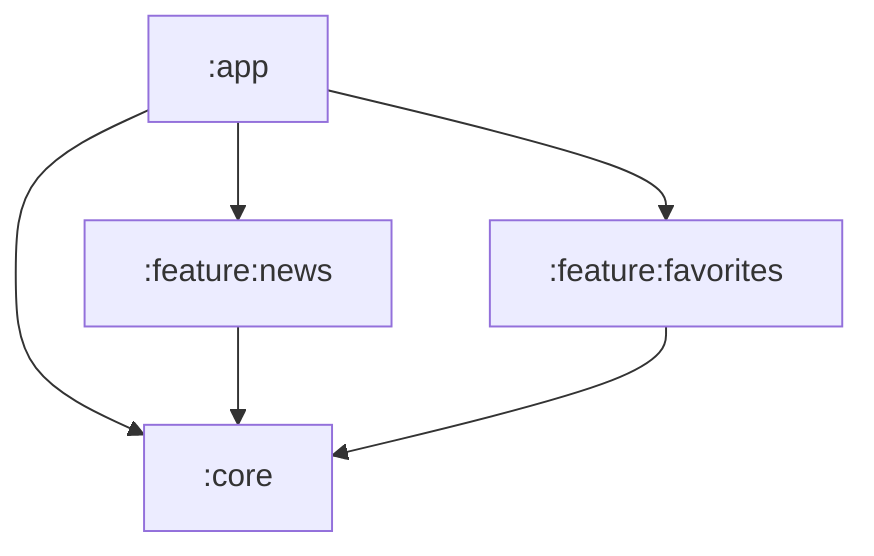

# News Architecture Demo

Aplicativo Android acadêmico inspirado em decisões do Now in Android: camadas,
ViewModels, fluxo unidirecional, repositórios, injeção e funcionalidades em
módulos separados. São 12 notícias fictícias, detalhes e favoritos persistidos
localmente. O aplicativo funciona sem conexão e não solicita acesso à internet.

## Requisitos e execução

- JDK 17, Android SDK Platform 36 e Build Tools 35.0.0.
- Emulador ou aparelho Android API 26 ou superior.
- Internet apenas na primeira resolução das dependências de compilação.
- Gradle 8.13, distribuído pelo wrapper com SHA-256 verificado.

Abra esta pasta no Android Studio, selecione JDK 17 para o Gradle e aguarde a
sincronização. Se necessário, crie `local.properties` com
`sdk.dir=/caminho/para/Android/sdk`. Esse arquivo é específico da máquina e não
é incluído no pacote de fontes.

No macOS, com SDK no local padrão:

```sh
export JAVA_HOME=$(/usr/libexec/java_home -v 17)
export ANDROID_HOME="$HOME/Library/Android/sdk"
./gradlew :app:assembleDebug
"$ANDROID_HOME/emulator/emulator" -avd Medium_Phone_API_36.1 -no-snapshot-save
"$ANDROID_HOME/platform-tools/adb" install -r app/build/outputs/apk/debug/app-debug.apk
"$ANDROID_HOME/platform-tools/adb" shell am start -n br.edu.arquitetura.newsdemo/br.edu.arquitetura.newsdemo.app.MainActivity
```

O nome do AVD é o usado na validação local. Em outra máquina, substitua pelo
nome exibido por `emulator -list-avds`. Também é possível executar pelo botão
Run do Android Studio. No Windows, use `gradlew.bat` e configure os caminhos
correspondentes do SDK e do JDK.

## Funcionalidades

- Lista ordenada por data, com categoria, título e descrição.
- Leitura dos detalhes e navegação de retorno.
- Salvar/remover favorito na lista e nos detalhes.
- Favoritos observáveis, atualizados entre telas e preservados após fechar.
- Estados explícitos de carregamento, sucesso, vazio, erro e notícia ausente.
- Falha de gravação preserva conteúdo e oferece nova tentativa.
- Bloqueio de repetição da gravação de um item enquanto ela está pendente.
- Tema claro/escuro, rótulos de acessibilidade e marcadores com alvo de 48 dp.

Estados de erro são exercitados com fakes nos testes; não há botões artificiais
para provocar falhas na interface do usuário.

## Arquitetura



| Módulo | Conteúdo |
|---|---|
| `app` | `NewsApplication`, `MainActivity`, navegação e composição Hilt |
| `core` | `model`, `domain`, `data`, `database`, `di` e `ui` |
| `feature/news` | `NewsViewModel`, `NewsDetailViewModel` e telas |
| `feature/favorites` | `FavoritesViewModel` e tela |

O domínio contém `ObserveNewsWithFavoritesUseCase`, que combina o catálogo e
os identificadores salvos e ordena por data. O mesmo caso de uso atende três
ViewModels. As interfaces `NewsRepository` e `FavoritesRepository` pertencem
à camada de dados. O banco, o DAO e as entidades são internos ao núcleo.

`FeedStateHolder` é um colaborador de apresentação, composto pelos ViewModels,
que concentra estados, cancelamento da observação, mensagens e operações
pendentes. Ele não pertence ao domínio. Compose apenas observa estado e
encaminha eventos. O módulo principal coordena navegação por callbacks;
funcionalidades não dependem umas das outras.

Fluxo de gravação: tela → ViewModel/estado → `FavoritesRepository` → DAO/Room.
Fluxo de atualização: Room → Flow → caso de uso → estado → Compose.

O catálogo imutável fica empacotado no aplicativo; Room guarda uma tabela de
identificadores favoritos. O esquema versão 1 é exportado em `core/schemas`.
Não há migrações anteriores nem limpeza destrutiva automática do banco.

## Tecnologias

Kotlin 2.2.21, Compose Compiler 2.2.21, Compose BOM **estável** 2025.09.01,
Material 3, Lifecycle 2.9.4, Navigation Compose 2.9.5, Coroutines 1.10.1,
Room 2.8.5, Hilt 2.57.2, KSP 2.2.21-2.0.4 e AGP 8.11.1. As versões estão em
`gradle/libs.versions.toml`. AndroidX Test 1.7.0, extensão JUnit 1.3.0 e
Espresso 3.7.0 são usados nos testes para compatibilidade com Android 16.

## Testes

```sh
./gradlew testDebugUnitTest
./gradlew lintDebug
./gradlew :core:connectedDebugAndroidTest
./gradlew :app:connectedDebugAndroidTest
```

As duas últimas tarefas precisam de um emulador/dispositivo iniciado. Execute-as
em sequência para evitar concorrência entre instrumentações no mesmo aparelho.
Os relatórios ficam em `*/build/reports`; as evidências da execução entregue
estão no diretório `docs/evidencias` da raiz da entrega.

Os testes unitários verificam caso de uso, catálogo, repositório com DAO fake e
os três ViewModels. Os testes instrumentados verificam Room real, reabertura
do arquivo, reatividade, navegação e um recorte de rótulos/áreas de toque.
Um teste exploratório coleta dez tempos entre gravação e emissão combinada;
isso não mede a renderização final da interface.

## Relação com o Now in Android

A referência é o commit `2982e63cb691ad49cd009aab43dc206fee6699c2` do
[Now in Android](https://github.com/android/nowinandroid). A aplicação foi
implementada separadamente, sem copiar o repositório inteiro.

A demonstração mantém UDF, repositórios, Flow, Hilt e modularização. Simplifica
o original usando quatro módulos e dados exclusivamente locais. No original,
Room guarda conteúdo e Proto DataStore guarda dados do usuário; aqui Room
persiste favoritos. Não há API, WorkManager, notificações, analytics ou divisão
`api`/`impl` das funcionalidades. A demonstração é local; não implementa os
problemas de sincronização de uma aplicação com fontes remotas.
